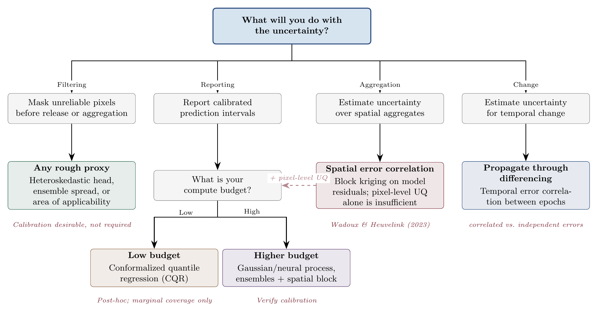

We organize UQ methods along two axes by whether uncertainty is intrinsic to the model (produced during training) or applied post hoc, and what type of uncertainty each method captures. @tbl-uq-methods provides a summary and we discuss each family below. The methods below represent different points on the trade-off between statistical rigor and computational feasibility, and no existing method occupies the ideal corner of that space.

| **Method** | **Captures** | **Overhead** | **EO failure modes** | **Calibrated?** |
| --- | --- | --- | --- | --- |
| Gaussian Processes | Both | $O(n^3)$ | Kernel misspecification or non-stationarity | ✓$^*$ |
| Heteroskedastic NN | Aleatoric | $1\times$ | Blind to epistemic; weak variance signal | × |
| Distributional regression | Aleatoric | $1\times$ | Distribution family misspecification | × |
| Neural Processes | Both | $1\times$ | VI approximation error | $\sim$ |
| Deep Ensembles | Epistemic | $N\times$ | Correlated members from data | × |
| MC Dropout | Epistemic | $K\times$ | Systematic underestimation | × |
| Cheap ensembles$^\dagger$ | Epistemic | $1.2$--$2\times$ | Same as ensembles, reduced | × |
| Quantile Regression | Aleatoric | $1$--$Q\times$ | No calibration guarantee; crossing | × |
| Conformal Prediction | Marginal | $1\times$ | Only marginal coverage; exchangeability | ✓$^\ddagger$ |
| CQR | Both$^\S$ | $1\times$ | Marginal not conditional coverage | ✓$^\ddagger$ |

: Overview of uncertainty quantification methods for large-scale EO maps. Inference overhead is relative to a single forward pass. "Calibrated" indicates whether the method produces well-calibrated intervals by theoretical construction (✓), requires post-hoc calibration ($\sim$), or provides no calibration guarantee (×). $^*$ If kernel correctly specified. $^\dagger$ Snapshot ensembles, SWAG, BatchEnsemble. $^\ddagger$ Marginal coverage guaranteed; conditional coverage not guaranteed for spatial data. $^\S$ Inherits aleatoric adaptivity from base quantile model and the conformal wrapper provides marginal epistemic correction. {#tbl-uq-methods}

## Intrinsic methods

### Gaussian processes

Gaussian processes (GPs) provide the theoretically principled baseline for spatial prediction with uncertainty [@rasmussen2005gaussianprocesses]. Under a well-specified kernel, the GP posterior yields exact, calibrated predictive distributions including at unobserved locations, which is the inference setting for map generation. The classical limitation is computational as exact GP inference scales as $O(n^3)$ in the number of observations (pixels usually), which is prohibitive for the millions-to-billions of data points typical of global EO datasets.

Sparse approximations based on inducing points [@titsias2009variational; @hensman2013gaussian] reduce the cost to $O(nm^2)$ where $m \ll n$, making GPs feasible for moderately large datasets. However, the choice of kernel function is significant and the placement of inducing points is itself also an optimization problem that interacts with kernel specification. A fixed inducing set may adequately represent covariance structure in data-dense regions while underrepresenting data-sparse ones, precisely where uncertainty estimates matter most. For non-stationary EO data, this means the user must jointly navigate kernel selection, inducing point placement, and potential domain partitioning, which often require domain expertise.

EO data are non-stationary (tropical forests and savannas have fundamentally different covariance structures), and misspecifying the kernel undermines the calibration that is the GP's principal advantage. The geostatistical literature, where GPs appear under the name *kriging*, has a long history of addressing non-stationarity and change-of-support problems [@cressie1993statistics; @goovaerts2001geostatistical] and these insights remain relevant even as the ML community increasingly favors neural approaches.

### Heteroskedastic and distributional regression

The simplest neural approach to uncertainty is to add a second output head predicting the variance alongside the mean, trained via a Gaussian negative log-likelihood loss [@nix1994estimating]. This captures aleatoric uncertainty cheaply (because the overhead is a single additional output neuron) but is blind to epistemic uncertainty. If the model is systematically wrong in some region (e.g., due to training data gaps), the variance head will not reflect this. The training signal for the variance head is also weak since the model must learn the noise structure from the same data it uses to learn the function, and the loss landscape for the variance parameter is poorly behaved when the model is misspecified.

More expressive approaches predict the full parameters of a flexible distribution rather than just a Gaussian mean and variance. For skewed variables such as biomass, where a Gaussian assumption is often inappropriate even after log-transformation, mixture density networks [@bishop1994mixture] or distributions with explicit skewness and kurtosis parameters (e.g., sinh-arcsinh normal) [@jonespewsey2009] offer a richer representation of predictive uncertainty.

### Variational inference and neural processes

Neural processes (NPs) [@garnelo2018conditional; @kim2018attentive] can be understood as amortized variational approximations to Gaussian processes. They learn to map a set of context observations to a predictive distribution, much as kriging maps observations to a conditional Gaussian, but with the kernel learned implicitly rather than specified parametrically. This connection to the geostatistical framework that underpins decades of spatial prediction is underappreciated, in part because the NP literature has developed largely within the meta-learning community using different vocabulary and training conventions. From the perspective of an EO researcher already familiar with kriging, the core proposition is not a new uncertainty framework but a scalable approximation to an existing one, with $O(n)$ inference cost and the capacity to learn non-stationary covariance structure directly from data.

The standard caveats of variational inference apply. The approximate posterior can underestimate uncertainty if the variational family is too restrictive, and the ELBO objective can trade off data fit against KL divergence in ways that are not transparent. In practice, design choices specific to the NP framework can produce well-calibrated prediction intervals. As an example, Young and Keshav [@young2026interpolation; @young2026neural] demonstrated that attentive neural processes produce residual standard deviations near the ideal value for biomass mapping across ecologically distinct regions, including under active deforestation. However, these remain among the few validated applications of NPs in large-scale EO mapping, and broader adoption has been limited by the absence of mature tooling and the unfamiliarity of the meta-learning paradigm.

## Post-training methods

### Ensembles

Deep ensembles [@lakshminarayanan2017deep] train $N$ models with different random seeds or bootstrap samples and take the spread as an uncertainty estimate. Their dominance in practice is largely explained by their simplicity. Ensembles require no changes to the base model architecture, loss function, or training pipeline. One simply trains the same model multiple times and measures disagreement. Random forests offer an even lower barrier, since every tree is already an ensemble member and quantile regression forests [@meinshausen2006quantile] formalize this by retaining the full distribution of training samples at leaf nodes. For those already using tree-based methods for mapping, uncertainty estimates are essentially a byproduct.

As an example, Lang et al. [@lang2022canopy] estimated uncertainty in global canopy height predictions using an ensemble of heteroskedastic CNNs, where each member predicts both a mean and a variance via Gaussian negative log-likelihood. Aleatoric uncertainty is estimated by averaging the individual variance predictions, and epistemic uncertainty by the variance of the individual means with a decomposition that follows the law of total variance. The approach illustrates both the appeal and the cost, as the heteroskedastic heads required no post-hoc calibration step, but inference at global scale meant running ten forward passes over the full domain.

However, ensemble spread measures model disagreement, which is related to but distinct from prediction interval width. For bootstrap based ensembles, including random forests, samples drawn from spatially autocorrelated data overlap substantially, and Wager et al. [@wager2014randomforestsci] showed that the resulting confidence intervals are only valid under conditions that such data systematically violate. Deep ensembles face a more severe form of the same problem class as members typically share the entire training set and differ only in random initialization, so the sole source of disagreement is optimization stochasticity. When the training data contain spatially structured biases as EO data invariably do, all members learn similar biases in the same regions and agree with each other where they are collectively wrong. In both cases, the mechanism parallels the well documented effect by which spatial autocorrelation inflates apparent model accuracy [@ploton2020spatialvalidation; @Roberts2017]: the same data structure that makes test-set $R^2$ overly optimistic makes ensemble spread overly narrow.

Several approaches reduce the computational cost of ensembles without addressing the spread-versus-interval issue. Monte Carlo dropout [@gal2016dropout] approximates an ensemble by applying dropout at test time, but systematically underestimates uncertainty because it explores a narrow region of weight space. Snapshot ensembles [@huang2017snapshot] collect checkpoints along a cyclic learning rate schedule. Stochastic Weight Averaging (SWA/SWAG; @izmailov2018averaging) averages weights or samples from a Gaussian approximation to the weight posterior. BatchEnsemble [@wen2020batchensemble] shares most parameters across members, reducing cost to approximately $1.2\times$ a single model. FiLM-Ensemble [@turkoglu2022film] modulates network activations via feature-wise linear modulation to produce diverse ensemble members from a single base network, achieving calibration comparable to explicit ensembles at a fraction of the memory cost. These techniques change the cost--calibration trade-off but do not resolve the correlation-induced miscalibration when applied to spatially structured data.

### Quantile regression

Rather than deriving prediction intervals from a point-estimate model, quantile regression directly targets conditional quantiles by optimizing a pinball (check) loss [@koenker1978regression]. One can train separate models for the $\tau$-th and $(1-\tau)$-th quantiles, or use a single model with multiple quantile heads, to obtain prediction intervals at any nominal level. Quantile Random Forests [@meinshausen2006quantile] retain the full distribution of training samples at leaf nodes to estimate conditional quantiles non-parametrically.

The appeal is directness as the model is optimized for the quantity of interest (interval bounds) rather than deriving intervals from variance estimates. The limitation is that there is no guarantee the resulting intervals are calibrated. A model trained for the 5th and 95th percentiles may achieve empirical coverage far from 90%. Quantile crossing (the upper bound falling below the lower bound) can also occur, though isotonic regression or architectural constraints can mitigate this.

### Conformal prediction

Conformal prediction [@vovk2005algorithmiclearning] provides distribution-free coverage guarantees. Given exchangeable calibration data, a conformal procedure produces prediction sets that contain the true value with at least the nominal probability. The accessible tutorial by Angelopoulos and Bates [@angelopoulos2023conformal] has driven recent adoption in the EO community [@singh2024uncertaintyconformal; @valle2023luluconformal].

The appeal is theoretical cleanliness as coverage is guaranteed without distributional assumptions, and practical cheapness since conformal methods operate as a post-hoc wrapper around any base predictor. The limitation for spatial mapping is that the guarantee is marginal. The coverage holds on average over the full test distribution, not conditionally for specific regions or subpopulations. For a map user who needs to know how uncertain a given pixel is in the Amazon, a guarantee that averages over the entire globe is of limited value.

More fundamentally, standard conformal prediction assumes exchangeability of calibration and test points, which spatial autocorrelation violates. Spatially correlated data are not exchangeable: nearby points carry redundant information, and the effective calibration sample size is smaller than the nominal one [@young2026samples]. This can lead to coverage that is correct marginally but arbitrarily poor conditionally [@barber2023conformal]. To address this limitation, Guan [@guan2023localized] proposed localized conformal prediction, which emphasizes a local region around each test point when computing prediction sets, retaining the finite-sample marginal coverage guarantee while offering additional local coverage guarantees under suitable assumptions. Adapting such methods to the data volumes and non-stationarities of global EO maps remains an open problem, but they represent a promising direction beyond purely marginal guarantees.

Conformalized quantile regression (CQR; @romano2019conformalized) offers a middle ground. CQR uses conformal calibration to adjust model-produced quantile intervals, inheriting the adaptivity of the base quantile model while gaining the marginal coverage guarantee. Kuronen et al. [@kuronen2025conformal] applied conformal prediction with a regression model to forest attribute mapping, using split conformal inference to construct prediction intervals and evaluating empirical coverage on withheld test data. While CQR does not solve the conditional coverage problem for spatial data, it is a practical post-hoc calibration approach that is currently available.

### Classification

For categorical maps the natural uncertainty output is the class probability vector, typically from a softmax layer, and several of the methods above transfer directly. Ensembles and MC dropout provide epistemic uncertainty as disagreement between members' probability vectors, and the aleatoric/epistemic decomposition follows the same law-of-total-variance logic as in the continuous case, expressed as total predictive entropy minus expected entropy (the mutual information between prediction and model parameters [@houlsby2011bayesian; @kendall2017uncertainties]). Conformal prediction yields prediction sets of classes rather than intervals, with the same marginal guarantee and the same exchangeability caveat [@angelopoulos2023conformal]. Quantile regression has no categorical counterpart.

However, the difference from regression lies in calibration. Raw softmax probabilities are usually miscalibrated, and modern networks are systematically overconfident [@guo2017calibration]. Temperature scaling, a single scalar fitted on held-out data, is the standard post hoc fix and is often sufficient. Platt scaling and isotonic regression handle non-uniform miscalibration [@niculescu2005predicting], and class-wise or Dirichlet calibration is needed when miscalibration differs by class [@kull2019beyond]. Focal loss is a training-time alternative that implicitly regularizes toward higher-entropy outputs [@mukhoti2020calibrating]. A further distinction is that area estimation from a categorical map depends on the full probability vector, not only the top-label probability, so calibration of the entire vector matters even when only the argmax is used for producing outputs (see [Assessing calibration](uq_calibration.qmd)).

## Methods summary

Unfortunately no method is simultaneously cheap, scalable, and well-calibrated. Gaussian Processes are calibrated (if the kernel is correct) but do not scale. Ensembles scale but are expensive and can be prone to overconfidence for spatial data. Conformal methods are cheap but provide only marginal coverage. Neural processes offer a favorable trade-off but require bespoke architectures. Heteroskedastic regression is cheap and scalable but captures only aleatoric uncertainty.

The appropriate choice depends on what will be done with the uncertainty. If the goal is to mask out unreliable regions, even a rough uncertainty proxy may suffice. If the goal is to produce calibrated prediction intervals for carbon accounting, the requirements are stringent and the cost is correspondingly higher. If the goal is to report aggregate uncertainty over administrative units, the dominant concern is spatial error correlation (see [Spatial structure of uncertainty](uq_spatial.qmd)), and no pixel-level UQ method alone will suffice. Users should articulate the intended use of uncertainty before choosing a method, not after. @fig-uq-flowchart summarizes the decision logic discussed in the sections that follow.

{#fig-uq-flowchart}
